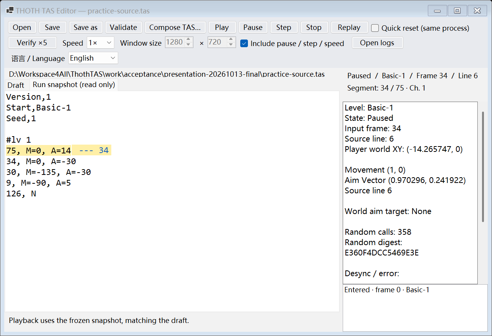
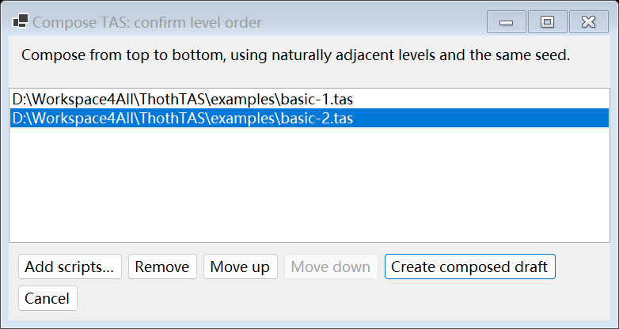

# Actual validation — 0.2.0 / 2026-10-13

The released editor ran the actual independent THOTH copy on the current Windows computer, pinned to `THOTH-2019-09-10-174628-r239`, Unity 5.3.6p5 x86 Mono. These results apply to the stated scripts and paths. Compilation and screenshots alone do not establish replay determinism.

## Current editor

| Check | Actual result |
| --- | --- |
| Presentation suite | 24 checks passed; 3 independent game processes, 274 / 495 / 495 input frames |
| Inline marker | Visible blue `--- 34` on the highlighted source line, RGB(25,99,190); absent from script/snapshot/save contents |
| Language | English/简体中文 dropdown during pause and playback; persistence, restored preference, no paused frame/RNG advance |
| Compose window | Displayed English window; add/remove/up/down/accept, then production Compose button generated Room chapters |
| Composed replay | Two cold runs finish both rooms at frame495; complete `frames.jsonl` and `random.tsv` are byte-identical, including the run with live language switches |
| Editing regression | 17 checks passed with this editor: live source line, segment progress, chapter events, warm reset, composition and real TCP disconnect |
| Pure core checks | 113 passed, 0 failed; these do not run the game |

Basic-1 completes at frame147, Basic-2 player activates at frame273, and Basic-2 completes at frame495. The two source budgets sum to799; completed chapters skip unused tails. The supplied sources have the original SHA256 values.

Native file-picker paths are injected by self-tests. Production buttons and the displayed compose window are exercised; native OS picker interaction is not covered. UI images are displayed WinForms control renders, not desktop screenshots or evidence of foreground focus.

## Earlier evidence with the same runtime module

The runtime and preloader have not changed for this editor update. Earlier editor evidence is retained as earlier evidence, not represented as a new run of every path:

- Seven representative scripts: 26 independent processes, exact initial baseline, per-frame gameplay/phase/RNG data and complete random records. Paths include movement, bullets, collision callbacks, death, teleportation, Boss state progression and natural transition.
- This Basic-1/Basic-2 composition: six cold processes covering continuous, pause/resume, stepping,0.5× and2×; all495 frames matched.
- Four actual special cases, eight cold processes: angle/vector/world targets including negative/decimal/coincident points, differing seeds, first input divergence at frame2, disconnect and protocol handling.
- Three cold editor sessions and six real focus switches: physical arrows, draft editing/saving, speeds, pause and stepping matched continuous playback. This focus suite was not repeated for the presentation-only update.

The representative index observed41 of158 static direct Unity random call sites;117 were not observed. Static discovery is not proof of execution. Boss progression is covered, Boss defeat is not. Not all ordinary start rooms were individually retested.

## Evidence and reproduction

[Machine-readable summary](verification-20261013.json) lists actual run IDs, record counts, script hashes, log hashes, current tool hashes and exact checks. Full original CIL and session logs remain local. The source includes the actual self-test entry points:

```powershell
.\dist\editor\ThothTAS.Editor.exe --self-test-presentation .\examples\basic-1.tas .\examples\basic-2.tas --out .\work\acceptance\presentation
dotnet run --project .\tests\ThothTAS.Core.Tests -c Release
.\dist\host\ThothTAS.Host.exe verify .\examples\composed\basic-1-basic-2.tas --count 2 --modes --out .\work\verification\joined
```

Choose a fresh output directory. The presentation test uses temporary practice/save files and checks source hashes. Run from the project root after creating your own pinned game copy. Actual-game tests take control of the copy they launch.

## Remaining limits

Independently successful levels do not automatically compose successfully: later levels inherit earlier random consumption, clocks and entry state. Verify the complete composition. Quick reset keeps native process state and is practice only, not cold-start equivalent. No cross-computer, instant-save, rewind, seeking, two-player, Hardcore or generated-mode guarantee. The tool synchronizes selected sound loading and normalizes LaserBeat/RhythmLaser gameplay clocks by input frames; it does not claim every instantaneous ordinary realtime behavior is unchanged.

## UI renders




